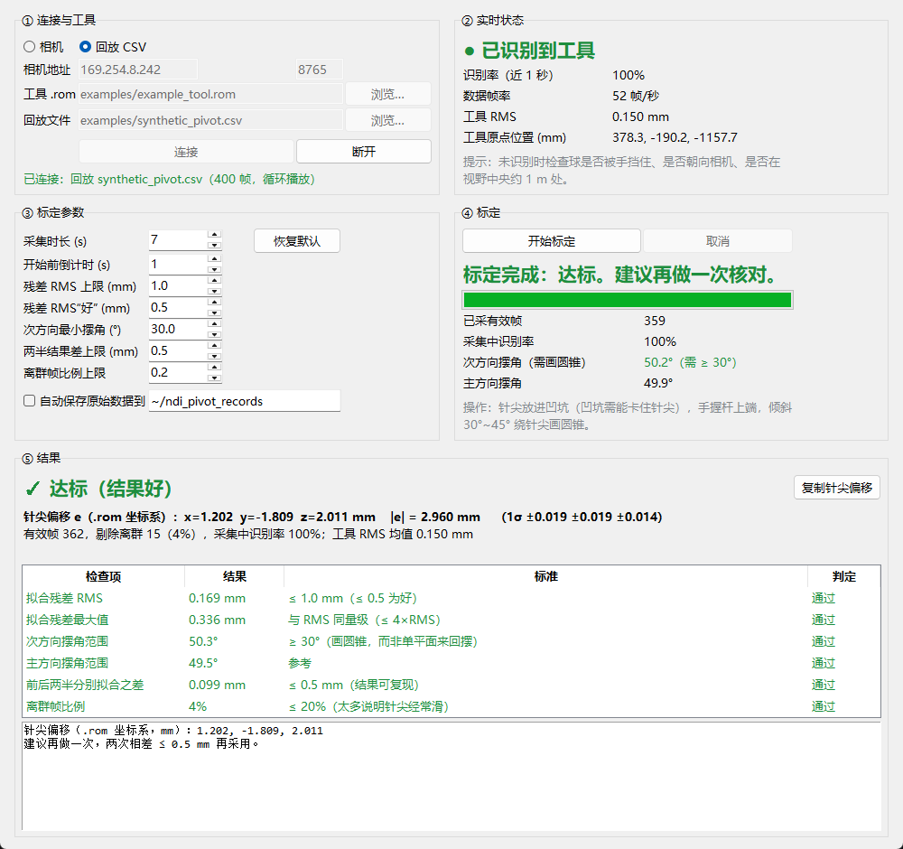

# ndi-pivot-calibration

Robust pivot (tip) calibration for **NDI Polaris** optical tools — a small GUI and command-line tool that talks to the camera directly over TCP (no NDI SDK).

[中文说明见下方](#中文说明)



## Why

Standard pivot calibration fits every frame with one least-squares solve. If the tip slips out of the divot for a moment, or a marker is briefly occluded, those frames silently drag the result off by millimetres — and you only get a number, not a reason.

This tool fits the same pivot model, but:

- **rejects outlier frames** (tip slipped, marker occluded) iteratively — median + 3·MAD, never below 0.3 mm;
- **grades the session** instead of just printing a number: residual RMS, max residual, cone coverage (did you draw a cone or swing in one plane?), split-half repeatability, outlier fraction;
- shows **live status** while you work: is the tool recognised, frame rate, tool RMS, and the swing angles updated every second during recording;
- saves raw poses to CSV so any session can be **replayed or re-analysed** offline.

## Requirements

- Python 3.8+ with `numpy` (`tkinter` ships with the standard Windows/macOS Python installers)
- An NDI Polaris camera reachable over Ethernet (tested on Polaris Vega XT, API revision G.003.007), port 8765
- The `.rom` tool definition file of a **passive** tool

```bash
pip install -r requirements.txt
```

## Usage

GUI:

```bash
python ndi_pivot_gui.py
```

1. Pick the tool `.rom`, enter the camera address, **Connect**. Close any other software connected to the camera first (NDI accepts one connection).
2. Wait until the status turns green: **tool recognised**.
3. Put the tip in a divot, **Start**, and after the countdown rotate the tool around the tip, drawing a cone (tilt 30–45°, all directions).
4. Read the graded result. Accept it only when all checks pass, ideally twice in a row with tip offsets within 0.5 mm.

To try it without a camera: choose **Replay CSV**, tool `examples/example_tool.rom`, data `examples/synthetic_pivot.csv` (synthetic; true tip offset (1.20, −1.80, 2.00) mm; regenerate with `examples/make_example.py`).

Command line:

```bash
python ndi_pivot.py --rom my_probe.rom --save run1.csv      # record 40 s and analyse
python ndi_pivot.py --rom my_probe.rom --load run1.csv      # re-analyse offline
python ndi_pivot.py --rom examples/example_tool.rom --load examples/synthetic_pivot.csv   # example
```

## Output

`e` — the tip position in the tool (`.rom`) coordinate frame, in mm. Use it as the tool-tip offset in your application: `tip_world = R · e + t`, where `R`, `t` are the tool pose reported by the camera.

## Getting a good calibration

- **The divot must hold the tip.** Hand-holding the tip still does not work: millimetre-level wandering is invisible to you but ruins the fit. A cone-shaped hole drilled into metal (not through) is ideal; a Phillips screw head works in a pinch.
- **Hold the tool by the far end of the shaft**, not near the tip — fingers near the tip become the pivot point (the fitted "tip" then lands several mm up the shaft).
- **Draw a cone**, not a single back-and-forth swing; the minor swing range must reach ~30°.
- Keep all markers facing the camera and unoccluded.
- Recalibrate after replacing marker spheres.

## Grading defaults

| Check | Default |
|---|---|
| Residual RMS | ≤ 1.0 mm (≤ 0.5 mm good) |
| Max residual | ≤ 4 × RMS |
| Minor swing range | ≥ 30° |
| Split-half difference | ≤ 0.5 mm |
| Outlier fraction | ≤ 20 % |

All limits can be changed in the GUI.

## Files

| File | Content |
|---|---|
| `ndi_camera.py` | TCP connection, passive tool loading (`PHRQ`/`PVWR`/`PINIT`/`PENA`), `TX 0001` parsing, `.rom` reading |
| `ndi_pivot.py` | Pivot fit, outlier rejection, grading; command-line entry |
| `ndi_pivot_gui.py` | tkinter GUI |

## Notes

- Only the `TX 0001` reply option and passive tools are supported.
- Link-local cameras (169.254.x.x): VPN/proxy adapters (e.g. Tailscale) can capture that route; the client binds to each local link-local adapter first to work around this.
- Not a medical device. Validate any calibration in your own system before relying on it.

## License

MIT

---

## 中文说明

**NDI Polaris** 光学工具的稳健针尖枢轴标定工具：图形界面 + 命令行，直接通过 TCP 与相机通信，不需要 NDI SDK。

### 为什么做这个

常规枢轴标定把所有帧一次性做最小二乘。针尖中途滑出凹坑、或某一刻球被挡住，这几帧就会把结果拉偏几毫米，而且只给一个数字，不告诉你原因。

本工具使用同样的枢轴模型，另外：

- **迭代剔除离群帧**（针尖滑动、球被遮挡）：中位数 + 3·MAD，下限 0.3 mm；
- **逐项判定质量**，而不是只给数字：残差 RMS、最大残差、是否画了圆锥（次方向摆角）、前后两半是否一致、离群帧比例；
- **实时状态**：是否识别到工具、帧率、工具 RMS，采集过程中每秒刷新摆角；
- 原始位姿保存为 CSV，可**回放、离线重算**。

### 使用
```bash
pip install -r requirements.txt
python ndi_pivot_gui.py
```

1. 选择工具 `.rom`、填写相机地址、点**连接**。先关闭其他连着相机的软件（NDI 只接受一个连接）。
2. 等状态变成绿色“已识别到工具”。
3. 针尖放进凹坑，点**开始标定**，倒计时后绕针尖画圆锥转动（倾斜 30°～45°，前后左右都转到）。
4. 看判定结果。所有检查都通过才采用；最好连做两次，两次针尖偏移相差 ≤ 0.5 mm。

没有相机时可以选“回放 CSV”，工具选 `examples/example_tool.rom`，数据选 `examples/synthetic_pivot.csv`（合成数据，真实针尖偏移为 (1.20, −1.80, 2.00) mm）。

### 结果怎么用

`e` 是针尖在工具（`.rom`）坐标系中的位置，单位 mm。在你的程序里作为针尖偏移：`针尖世界坐标 = R · e + t`，`R`、`t` 为相机报告的工具位姿。

### 怎样标得准

- **凹坑必须能卡住针尖**。徒手稳住针尖做不到：毫米级的游走人感觉不到，却会毁掉拟合。在金属上钻一个不钻穿的锥形坑最好；临时可用十字螺丝头。
- **握住杆的远端**，不要捏在针尖附近，否则手指会变成支点（拟合出的“针尖”会落到杆上几毫米处）。
- **画圆锥**，不要只在一个平面里来回摆；次方向摆角要达到约 30°。
- 球全程朝向相机、不被遮挡。
- 更换反光球后要重新标定。

### 说明

- 只支持被动工具和 `TX 0001` 回复格式。
- 不是医疗器械。任何标定结果都应在自己的系统中验证后再使用。

### 许可证

MIT
